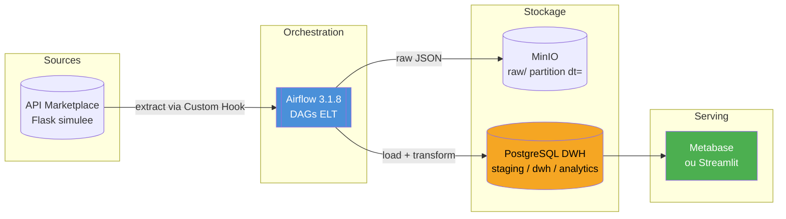
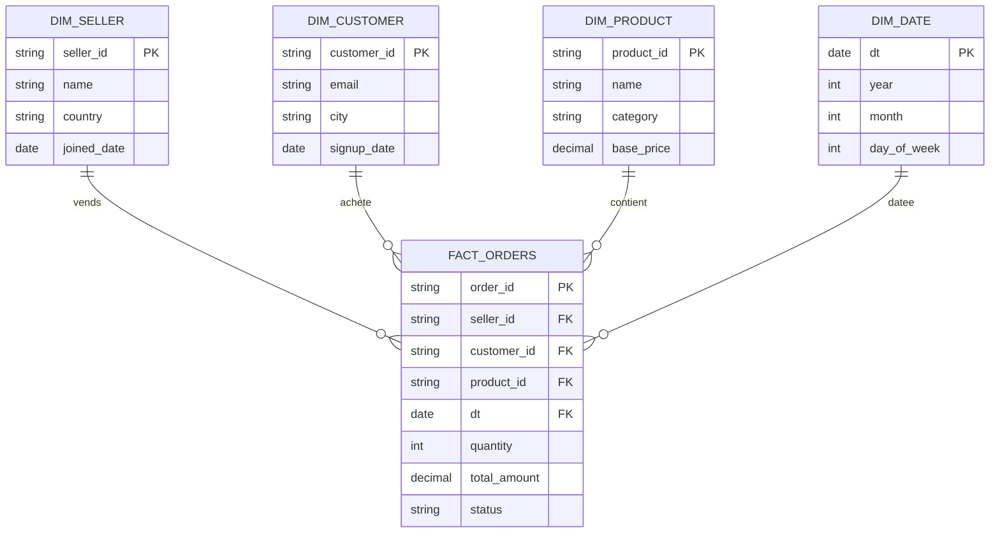
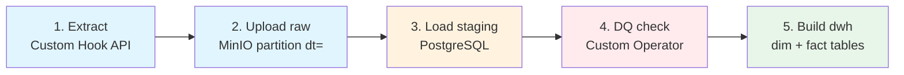
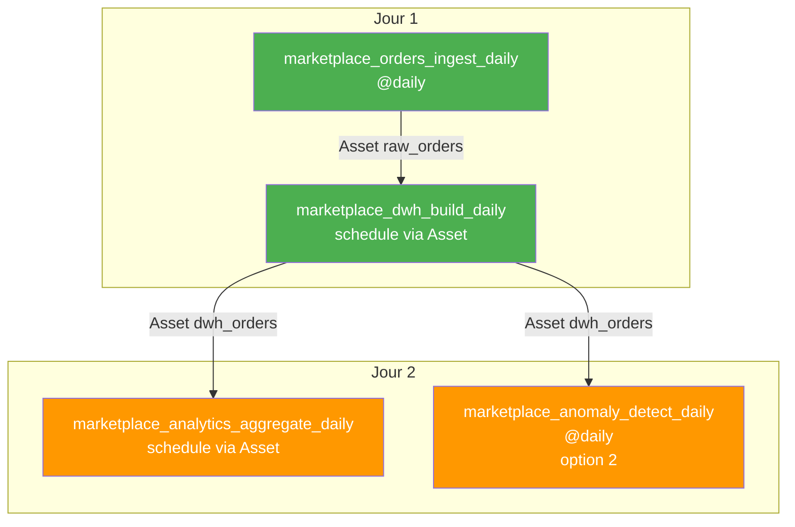

# Projet A — MarketPlace Analytics

> **Focus :** Orchestration ELT classique, idempotence, qualité de données, dashboards

## Le pitch

Vous êtes Data Engineer dans une marketplace e-commerce (type Etsy, Vinted, Backmarket).
Des dizaines de vendeurs y publient leurs produits, les clients achètent, les commandes
s'accumulent. Votre mission : construire la plateforme data qui alimente les dashboards
business (top vendeurs, revenu par catégorie, taux de churn client) et détecte les
anomalies commerciales (drop de ventes, prix suspects).

C'est un projet **ELT batch pur** — parfait pour les groupes qui veulent maîtriser les
fondamentaux d'Airflow sans se disperser sur du streaming.

## Objectifs pédagogiques

- Construire un pipeline ELT idempotent de bout en bout (API -> S3 -> PostgreSQL -> Analytics)
- Implémenter un **Custom Hook** pour l'API marketplace avec auth Bearer
- Implémenter un **Custom Operator** de data quality avec règles configurables
- Concevoir des **tables faits/dimensions** simples (modélisation dimensionnelle)
- Exposer les KPIs via un dashboard **Metabase** ou **Streamlit**
- Détecter des anomalies business simples (écart à la moyenne, seuils)

## Architecture cible

## Modèle de données cible

## Découpage en 2 jours

### Partie 1 : Pipeline ELT de base

**Livrables :**

- [ ] DAG `marketplace_orders_ingest_daily` — extraction + upload raw + load staging
- [ ] Custom Hook `MarketplaceAPIHook` avec méthodes `get_orders(date)`, `get_sellers()`, `get_products()`
- [ ] Custom Operator `DataQualityOperator` avec 5 règles SQL configurables
- [ ] DAG `marketplace_dwh_build_daily` — construction des dimensions + faits
- [ ] Idempotence testée : relancer 3 fois la même date -> même résultat
- [ ] Pattern `DELETE + INSERT` sur partition `dt = {{ ds }}`

### Partie 2 : Analytics & dashboard

**Au choix du groupe** — option 1 ou 2 :

#### Option 1 — Dashboard Metabase *(plus simple)*

- Ajouter **Metabase** dans le docker-compose (`metabase/metabase:latest`)
- Créer 4 dashboards dans Metabase connecté au PostgreSQL DWH :
  - Top 10 vendeurs par revenu
  - Évolution du CA par jour (7 derniers jours)
  - Répartition des ventes par catégorie
  - Clients actifs vs dormants
- DAG `marketplace_analytics_aggregate_daily` qui alimente les tables d'agrégation lues par Metabase

#### Option 2 — Dashboard Streamlit + détection d'anomalies *(plus technique)*

- Ajouter un service **Streamlit** dans le docker-compose
- DAG `marketplace_anomaly_detect_daily` qui :
  - Calcule la moyenne mobile 7 jours du CA par vendeur
  - Flag les vendeurs avec un drop > 30% vs la moyenne
  - Écrit les anomalies dans `analytics.anomalies`
  - Branching : si anomalies détectées -> appelle un webhook (simulé)
- Dashboard Streamlit qui affiche les KPIs + les anomalies détectées

## Stack Docker Compose

| Service | Image | Port | Rôle |
|---|---|---|---|
| airflow-* | `apache/airflow:3.1.8` | 8080 | Orchestrateur |
| postgres-airflow | `postgres:16` | 5432 | Metadata DB |
| postgres-dwh | `postgres:16` | 5433 | Data Warehouse |
| minio | `minio/minio` | 9000/9001 | Storage objet |
| api-simulee | Flask custom | 5000 | API marketplace |
| metabase | `metabase/metabase` | 3000 | Dashboards (option 1) |
| streamlit | Python custom | 8501 | Dashboards (option 2) |

## DAGs attendus

## Fonctionnalités bonus (si temps)

- Slack / webhook alerting sur échec DAG
- Tests pytest sur le Custom Operator (mock de la DB)
- Backfill manuel sur 1 semaine de données historiques
- Ajout d'une dimension `dim_category` enrichie avec un mapping externe

## Organisation du dépôt

| Dossier | Contenu |
|---|---|
| `dags/` | Les DAGs Airflow |
| `plugins/hooks/` | `MarketplaceAPIHook` |
| `plugins/operators/` | `DataQualityOperator` |
| `sql/` | DDL des schémas staging / dwh / analytics, requêtes de transformation |
| `api/` | API marketplace simulée (Flask) |
| `dashboards/` | Config Metabase (option 1) ou app Streamlit (option 2) |
| `tests/` | Tests pytest |
| `docs/` | Notes d'architecture, captures des dashboards |

## Points d'attention

- **Conflit de port 5433 :** le `postgres-dwh` du projet utilise 5433, déjà pris sur cette
  machine par le conteneur `carmen_poc_db`. Arrêter ce conteneur ou remapper le port avant
  de lancer la stack.
- **Images Docker :** les pulls Docker Hub sont bloqués sur ce poste (`pull access denied`)
  et les binaires MinIO ne sont plus distribués (`dl.min.io` renvoie 410 Gone). Prévoir une
  alternative pour MinIO, ou un registre accessible.
