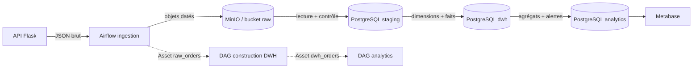

# Marketplace Analytics

Pipeline ELT quotidien pour une marketplace simulée : API Flask, archivage brut dans MinIO, entrepôt PostgreSQL et tableaux de bord Metabase. Airflow orchestre les étapes et transmet les partitions traitées entre DAGs avec des Assets.

## Architecture



Les deux bases PostgreSQL ont des rôles séparés : `postgres-airflow` conserve l’état et les métadonnées d’Airflow; `postgres-dwh` conserve staging, DWH, analytics et la base applicative Metabase. Metabase utilise sa propre base (`METABASE_DB`) pour ses comptes, questions et dashboards, sans écrire dans les tables métier. Les volumes Docker nommés conservent les données au redémarrage.

## Parcours des données

1. `marketplace_orders_ingest_daily` appelle l’API pour les commandes du jour UTC et les référentiels vendeurs, produits et clients. Le hook conserve le corps JSON tel que reçu dans `raw/marketplace/<ressource>/dt=YYYY-MM-DD/`. Les objets sont remplacés lors d’une relance de la même date. XCom ne transporte que les clés et empreintes SHA-256.
2. La tâche de chargement relit MinIO, vérifie les empreintes et le contrat des payloads, puis remplace transactionnellement les lignes de staging de cette date. Les snapshots de référence sont également remplacés. Une erreur annule la transaction.
3. `marketplace_dwh_build_daily`, déclenché par l’Asset `raw_orders`, met à jour les dimensions et remplace la partition de faits. `dwh.fact_orders` a une ligne par article commandé, clé `(order_id, product_id)`.
4. `marketplace_analytics_aggregate_daily`, déclenché par `dwh_orders`, produit le CA quotidien, les commissions, le CA par vendeur et par catégorie, l’activité client et les anomalies. Les tables dérivées sont recalculables sans doublons.
5. Metabase lit les tables `analytics`. Le script `dashboards/publish_metabase_dashboard.py` publie un dashboard unique avec six cartes.

Le CA comprend les commandes aux statuts `paid`, `shipped` et `delivered`, en EUR. Le taux de commission est configurable par `MARKETPLACE_COMMISSION_RATE` (0.12, soit 12 % par défaut). L’anomalie US-05 compare le CA d’un jour à 70 % de la moyenne des sept jours calendaires précédents, jour courant exclu.

## Tables et dashboards

- `staging`: `orders`, `order_items`, `sellers`, `products`, `customers`.
- `dwh`: dimensions `dim_seller`, `dim_product`, `dim_customer`, `dim_date` et table de faits `fact_orders`.
- `analytics`: `daily_revenue`, `seller_revenue_daily`, `category_revenue_daily`, `customer_activity`, `anomalies`.

Les fichiers `sql/ddl/00_schemas.sql` à `30_analytics.sql` définissent ces tables. `dwh-bootstrap` applique ces DDL idempotents au démarrage, y compris si le volume existe déjà. Les contrats détaillés des payloads, clés MinIO et Assets sont dans [docs/contracts.md](docs/contracts.md).

Le dashboard unique **Marketplace — Executive Summary** présente le CA et la
commission du dernier jour, leur évolution sur 30 jours, le CA par catégorie du
mois, les jours du mois sous le seuil de 70 % de la moyenne 7 jours et le top 10
des vendeurs du mois classé par chiffre d'affaires.

US-06 se fait en relançant le DAG d’ingestion sur une plage de dates dans Airflow; les deux DAGs aval suivent leurs Assets. US-07 : les échecs sont visibles dans Airflow. Une notification sortante nécessite un `AIRFLOW_ALERT_WEBHOOK_URL` configuré; sans cela le détail reste dans les logs Airflow.

## Démarrage

Copier `.env.example` vers `.env`, renseigner les secrets locaux, puis lancer depuis ce dossier :

```powershell
docker compose up -d --build
docker compose ps
```

Adresses par défaut : Airflow `http://localhost:8080`, Metabase `http://localhost:3000`, console MinIO `http://localhost:9001`, API `http://localhost:5001`. Les ports et paramètres sont dans `.env.example`. Depuis Metabase, PostgreSQL se joint avec l’hôte Docker `postgres-dwh` et le port interne `5432` (pas `localhost`).

Pour (re)publier le dashboard avec le compte administrateur Metabase déjà configuré :

```powershell
python .\dashboards\publish_metabase_dashboard.py
```

Le script lit les variables `METABASE_ADMIN_EMAIL` / `METABASE_ADMIN_PASSWORD` et `DWH_*` du `.env` local ou de l’environnement. Il ne journalise pas ces valeurs. Il réutilise et actualise les cartes et le dashboard existants; l'ancien « Pilotage quotidien » est repris comme « Executive Summary » et « Top Sellers » est supprimé. Les identifiants ne doivent pas être ajoutés au dépôt.

Les connexions Airflow `marketplace_api`, `dwh_postgres` et `minio_s3` sont injectées comme variables `AIRFLOW_CONN_*` dans Compose; aucun mot de passe n’est codé dans les DAGs. `airflow-init` et les autres services `*-init` s’arrêtent normalement après leur initialisation.

## Organisation du code

- `api/`: API Flask simulant les commandes et référentiels.
- `dags/`: définition des tâches, dépendances, horaires, Assets et connexions.
- `plugins/hooks/`: client API marketplace.
- `plugins/ingestion/`: validation, normalisation et chargement transactionnel de staging.
- `plugins/warehouse.py`: SQL de transformation staging → DWH → analytics, séparé de l’orchestration.
- `plugins/marketplace_config.py`: identifiants de connexions et Assets partagés.
- `plugins/marketplace_alerts.py`: notification optionnelle et callback d’échec.
- `sql/ddl/`: contrats physiques des schémas et tables.
- `dashboards/`: SQL des cartes et publication via l’API Metabase.
- `docs/contracts.md`: contrats d’interface et de données.

Pour rejouer une date, créer un backfill du DAG `marketplace_orders_ingest_daily` depuis l’interface Airflow ou avec `airflow backfill create` en précisant les dates de début et de fin. Le timetable UTC traite la date de l’intervalle; le jour transmis dans l’Asset est ensuite utilisé par les tâches aval.
