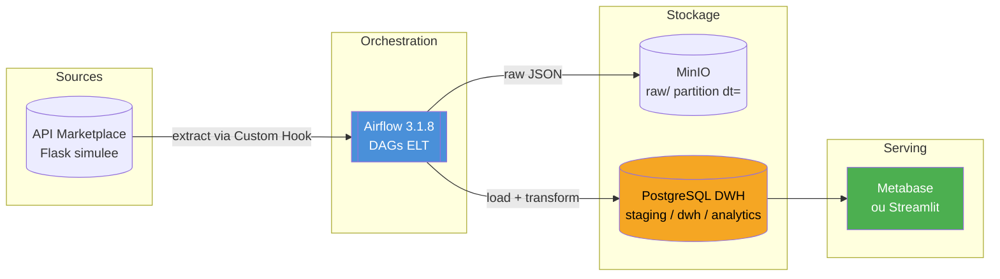
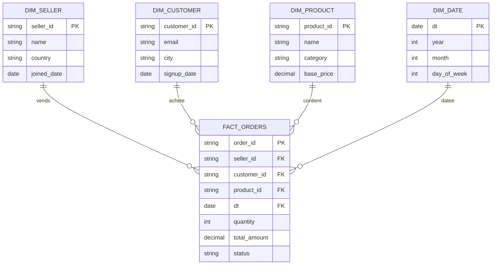
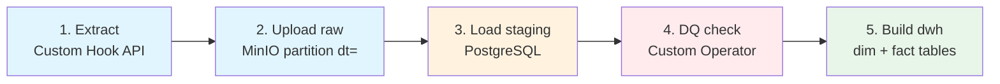
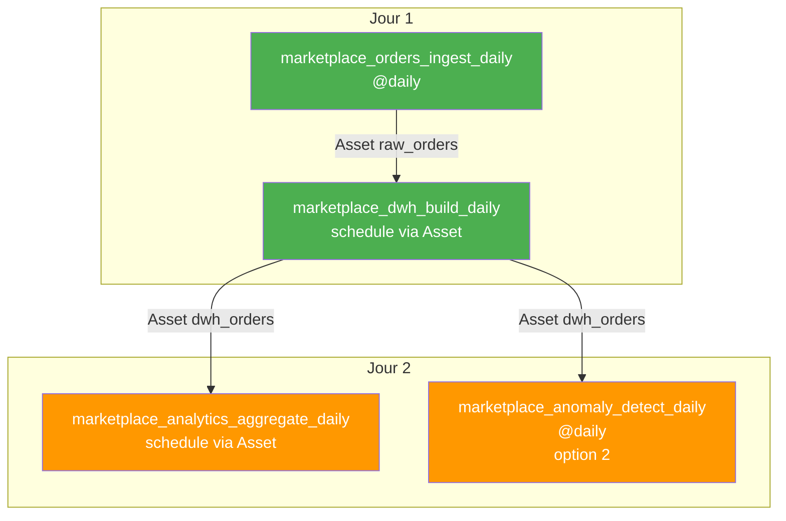

# Projet A — MarketPlace Analytics

> **Focus :** Orchestration ELT classique, idempotence, qualité de données, dashboards

## Le pitch

Vous êtes Data Engineer dans une marketplace e-commerce (type Etsy, Vinted, Backmarket).
Des dizaines de vendeurs y publient leurs produits, les clients achètent, les commandes
s'accumulent. Votre mission : construire la plateforme data qui alimente les dashboards
business (top vendeurs, revenu par catégorie, taux de churn client) et détecte les
anomalies commerciales (drop de ventes, prix suspects).

C'est un projet **ELT batch pur** — parfait pour les groupes qui veulent maîtriser les
fondamentaux d'Airflow sans se disperser sur du streaming.

## Objectifs pédagogiques

- Construire un pipeline ELT idempotent de bout en bout (API -> S3 -> PostgreSQL -> Analytics)
- Implémenter un **Custom Hook** pour l'API marketplace avec auth Bearer
- Implémenter un **Custom Operator** de data quality avec règles configurables
- Concevoir des **tables faits/dimensions** simples (modélisation dimensionnelle)
- Exposer les KPIs via un dashboard **Metabase** ou **Streamlit**
- Détecter des anomalies business simples (écart à la moyenne, seuils)

## Architecture cible



## Modèle de données cible



## Découpage en 2 jours

### Partie 1 : Pipeline ELT de base



**Livrables :**

- [ ] DAG `marketplace_orders_ingest_daily` — extraction + upload raw + load staging
- [ ] Custom Hook `MarketplaceAPIHook` avec méthodes `get_orders(date)`, `get_sellers()`, `get_products()`
- [ ] Custom Operator `DataQualityOperator` avec 5 règles SQL configurables
- [ ] DAG `marketplace_dwh_build_daily` — construction des dimensions + faits
- [ ] Idempotence testée : relancer 3 fois la même date -> même résultat
- [ ] Pattern `DELETE + INSERT` sur partition `dt = {{ ds }}`

### Partie 2 : Analytics & dashboard

**Au choix du groupe** — option 1 ou 2 :

#### Option 1 — Dashboard Metabase *(plus simple)*

- Ajouter **Metabase** dans le docker-compose (`metabase/metabase:latest`)
- Créer 4 dashboards dans Metabase connecté au PostgreSQL DWH :
  - Top 10 vendeurs par revenu
  - Évolution du CA par jour (7 derniers jours)
  - Répartition des ventes par catégorie
  - Clients actifs vs dormants
- DAG `marketplace_analytics_aggregate_daily` qui alimente les tables d'agrégation lues par Metabase

#### Option 2 — Dashboard Streamlit + détection d'anomalies *(plus technique)*

- Ajouter un service **Streamlit** dans le docker-compose
- DAG `marketplace_anomaly_detect_daily` qui :
  - Calcule la moyenne mobile 7 jours du CA par vendeur
  - Flag les vendeurs avec un drop > 30% vs la moyenne
  - Écrit les anomalies dans `analytics.anomalies`
  - Branching : si anomalies détectées -> appelle un webhook (simulé)
- Dashboard Streamlit qui affiche les KPIs + les anomalies détectées

## Stack Docker Compose

| Service | Image | Port | Rôle |
|---|---|---|---|
| airflow-* | `apache/airflow:3.1.8` | 8080 | Orchestrateur |
| postgres-airflow | `postgres:16` | 5432 | Metadata DB |
| postgres-dwh | `postgres:16` | 5433 | Data Warehouse |
| minio | `minio/minio` | 9000/9001 | Storage objet |
| api-simulee | Flask custom | 5000 | API marketplace |
| metabase | `metabase/metabase` | 3000 | Dashboards (option 1) |
| streamlit | Python custom | 8501 | Dashboards (option 2) |

## DAGs attendus



## Fonctionnalités bonus (si temps)

- Slack / webhook alerting sur échec DAG
- Tests pytest sur le Custom Operator (mock de la DB)
- Backfill manuel sur 1 semaine de données historiques
- Ajout d'une dimension `dim_category` enrichie avec un mapping externe

## Organisation du dépôt

| Dossier | Contenu |
|---|---|
| `dags/` | Les DAGs Airflow |
| `plugins/hooks/` | `MarketplaceAPIHook` |
| `plugins/operators/` | `DataQualityOperator` |
| `sql/` | DDL des schémas staging / dwh / analytics, requêtes de transformation |
| `api/` | API marketplace simulée (Flask) |
| `dashboards/` | Config Metabase (option 1) ou app Streamlit (option 2) |
| `tests/` | Tests pytest |
| `docs/` | Notes d'architecture, captures des dashboards |

## Demarrage de la stack

```bash
cp .env.example .env
# Renseigner les secrets, notamment :
#   python -c "from cryptography.fernet import Fernet; print(Fernet.generate_key().decode())"  -> AIRFLOW_FERNET_KEY
#   python -c "import secrets; print(secrets.token_urlsafe(32))"                               -> AIRFLOW_JWT_SECRET
docker compose up -d --build
```

Avec Metabase (option 1 de la partie 2) : `docker compose --profile metabase up -d`.

| Service | URL | Identifiants |
|---|---|---|
| Airflow | http://localhost:8080 | `admin` / `AIRFLOW_ADMIN_PASSWORD` |
| API marketplace | http://localhost:5001 | en-tete `Authorization: Bearer $MARKETPLACE_API_TOKEN` |
| Console MinIO | http://localhost:9001 | `MINIO_ACCESS_KEY` / `MINIO_SECRET_KEY` |
| PostgreSQL DWH | `localhost:5433` | `DWH_USER` / `DWH_PASSWORD`, base `marketplace` |
| Metabase | http://localhost:3000 | a creer au premier lancement |

Trois services s'executent une fois puis s'arretent, c'est normal : `airflow-perms`
(droits sur les volumes), `airflow-init` (migration de la base, mot de passe UI) et
`minio-init` (creation du bucket `raw`).

### Connections Airflow

Les trois `conn_id` du contrat sont injectes par variables d'environnement
(`AIRFLOW_CONN_*` dans le docker-compose), donc utilisables directement dans les DAGs
sans aucun secret en dur :

| `conn_id` | Type | Cible |
|---|---|---|
| `marketplace_api` | http | `http://api-simulee:5000`, jeton dans `password` |
| `dwh_postgres` | postgres | `postgres-dwh:5432`, base `marketplace` |
| `minio_s3` | aws | `endpoint_url=http://minio:9000` |

Attention : `airflow connections list` ne les affiche **pas**, car elles ne sont pas
stockees en base. Pour verifier qu'elles se resolvent :

```bash
docker compose exec airflow-scheduler python -c "
from airflow.sdk import BaseHook
print(BaseHook.get_connection('dwh_postgres').host)"
```

### Tests de l'API

```bash
pip install -r tests/requirements.txt
MARKETPLACE_API_TOKEN=<le-token-du-.env> API_BASE_URL=http://localhost:5001 \
    pytest tests/test_api_contract.py -v
```

20 tests couvrent l'authentification, les enveloppes JSON, les formats d'identifiants,
les invariants des commandes (`total_amount`, produits du bon vendeur, unicite) et le
determinisme du generateur.

## L'API simulee

Routes, toutes authentifiees sauf `/health` :

| Route | Reponse |
|---|---|
| `GET /health` | `{"status": "ok"}` — sans authentification |
| `GET /orders?date=YYYY-MM-DD` | `{"date", "count", "orders"}` |
| `GET /sellers` | `{"sellers": [...]}` |
| `GET /products` | `{"products": [...]}` |
| `GET /customers` | `{"customers": [...]}` |

Les donnees ne sont pas tirees au hasard : chaque valeur est derivee par hachage
SHA-256 de ses parametres. Une meme date renvoie donc toujours exactement les memes
commandes, ce qui est la condition pour pouvoir tester l'idempotence des DAGs.
12 vendeurs, environ 95 produits, 150 clients, et 25 a 65 commandes par jour.

`API_INJECT_ANOMALIES=true` (defaut) ajoute de la matiere aux parties suivantes :

- environ un jour sur sept, un vendeur perd ~80% de ses commandes (chute de CA a
  detecter en partie 2) ;
- environ une ligne de commande sur 200 porte un prix multiplie par 10 (anomalie a
  rattraper par le `DataQualityOperator`).

Mettre la variable a `false` produit un jeu de donnees propre.

## Points d'attention

- **Port 5000 indisponible sur macOS.** ControlCenter (recepteur AirPlay) ecoute deja
  dessus, d'ou `API_PORT=5001` cote hote. Le port **interne** du conteneur reste 5000 :
  les DAGs appellent bien `http://api-simulee:5000` comme prevu au contrat.
- **Port 5433 (DWH).** Valeur du sujet, conservee par defaut. En cas de conflit avec un
  autre PostgreSQL deja en ecoute, changer `DWH_HOST_PORT` dans `.env`.
- **MinIO vient de Chainguard, pas de Docker Hub.** Les depots `minio/minio` et
  `bitnami/minio` ont ete retires apres l'archivage du projet MinIO, et `dl.min.io`
  renvoie `410 Gone`. `chainguard/minio` est le meme serveur MinIO redistribue
  (`RELEASE.2026-09-22`), teste conforme : API S3 sur 9000, console sur 9001. L'image
  est distroless (aucun shell), donc pas de healthcheck Docker dessus : c'est
  `minio-init` qui attend activement que le serveur reponde.
- Les autres images (`apache/airflow:3.1.8`, `postgres:16`, `metabase/metabase`) se
  telechargent normalement.
