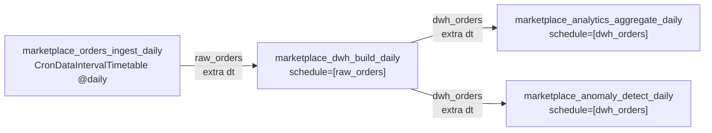

# Contrats d'interface — MarketPlace Analytics

> Statut : **contrat implémenté**. Toute modification de ce fichier doit être répercutée
> dans l'API simulée, le Hook, les DDL et les DAGs dans le même commit.

Conventions générales :

- Tous les noms (champs JSON, tables, colonnes, Connections) sont en `snake_case`.
- Toutes les dates et heures sont en **UTC**. Dates : `YYYY-MM-DD`. Horodatages : ISO 8601 avec `Z`
  (`2026-10-20T14:32:05Z`).
- Montants : nombres JSON à 2 décimales, en EUR. En SQL : `NUMERIC(12,2)`, jamais `FLOAT`.

---

## 1. API marketplace (format JSON)

Authentification : en-tête `Authorization: Bearer <MARKETPLACE_API_TOKEN>`. Sans jeton ou avec
un jeton invalide, l'API répond `401`.

| Endpoint | Méthode du Hook | Contenu |
|---|---|---|
| `GET /orders?date=YYYY-MM-DD` | `get_orders(date)` | Commandes passées ce jour-là (UTC) |
| `GET /sellers` | `get_sellers()` | Tous les vendeurs |
| `GET /products` | `get_products()` | Tous les produits |
| `GET /customers` | `get_customers()` | Tous les clients |

**Règle d'idempotence côté API :** pour une même `date`, `/orders` renvoie **toujours les mêmes
commandes** (générateur initialisé avec la date comme graine). Sans cette règle, on ne peut pas
tester l'idempotence du pipeline.

### 1.1 Identifiants

| Entité | Format | Exemple |
|---|---|---|
| Vendeur | `SEL-` + 4 chiffres | `SEL-0007` |
| Client | `CUS-` + 6 chiffres | `CUS-000042` |
| Produit | `PRD-` + 5 chiffres | `PRD-00315` |
| Commande | `ORD-` + date `YYYYMMDD` + `-` + 6 chiffres | `ORD-20261020-000123` |

Les identifiants sont des **chaînes** (`VARCHAR` en SQL), jamais des entiers.

### 1.2 Commande — `GET /orders?date=2026-10-20`

```json
{
  "date": "2026-10-20",
  "count": 1,
  "orders": [
    {
      "order_id": "ORD-20261020-000123",
      "order_ts": "2026-10-20T14:32:05Z",
      "customer_id": "CUS-000042",
      "seller_id": "SEL-0007",
      "status": "paid",
      "currency": "EUR",
      "items": [
        { "product_id": "PRD-00315", "quantity": 2, "unit_price": 19.90 },
        { "product_id": "PRD-00318", "quantity": 1, "unit_price": 45.00 }
      ],
      "total_amount": 84.80
    }
  ]
}
```

| Champ | Type | Règle |
|---|---|---|
| `order_id` | string | Unique, non nul |
| `order_ts` | string (ISO 8601 UTC) | `date(order_ts)` = paramètre `date` |
| `customer_id` | string | Existe dans `/customers` |
| `seller_id` | string | Existe dans `/sellers`. **Une commande = un seul vendeur** |
| `status` | string | `pending`, `paid`, `shipped`, `delivered`, `cancelled`, `refunded` |
| `currency` | string | Toujours `EUR` |
| `items` | array, non vide | Un `product_id` apparaît **au plus une fois** par commande |
| `items[].product_id` | string | Existe dans `/products`, appartient à `seller_id` |
| `items[].quantity` | integer | `>= 1` |
| `items[].unit_price` | number | `> 0`, prix réellement payé (peut différer de `base_price`) |
| `total_amount` | number | `= somme(quantity * unit_price)` |

Le chiffre d'affaires ne compte que les statuts `paid`, `shipped` et `delivered`.

### 1.3 Référentiels

```json
{ "sellers":   [ { "seller_id": "SEL-0007", "name": "Atelier Lune", "country": "FR", "joined_date": "2024-03-12" } ] }
{ "products":  [ { "product_id": "PRD-00315", "seller_id": "SEL-0007", "name": "Bougie soja", "category": "maison", "base_price": 19.90 } ] }
{ "customers": [ { "customer_id": "CUS-000042", "email": "client42@example.com", "city": "Lyon", "signup_date": "2025-11-02" } ] }
```

`country` : code ISO 3166-1 alpha-2. `category` : minuscules, sans accents (`maison`, `mode`,
`bijoux`, `electronique`, `jouets`, `beaute`).

---

## 2. Grain de la table de faits

**`dwh.fact_orders` contient une ligne par produit commandé** (ligne de commande).
Clé primaire : `(order_id, product_id)`.

| Colonne | Type | Source |
|---|---|---|
| `order_id` | VARCHAR | commande |
| `product_id` | VARCHAR, FK `dim_product` | `items[]` |
| `seller_id` | VARCHAR, FK `dim_seller` | commande |
| `customer_id` | VARCHAR, FK `dim_customer` | commande |
| `dt` | DATE, FK `dim_date` | `date(order_ts)` |
| `order_ts` | TIMESTAMPTZ | commande |
| `status` | VARCHAR | commande (répété sur chaque ligne) |
| `quantity` | INTEGER | `items[]` |
| `unit_price` | NUMERIC(12,2) | `items[]` |
| `line_amount` | NUMERIC(12,2) | `quantity * unit_price` |

Différence avec le schéma du README : la clé n'est plus `order_id` seul, et `total_amount`
devient `line_amount`. Le montant total d'une commande se calcule par
`SUM(line_amount) GROUP BY order_id`. Le nombre de commandes se calcule par
`COUNT(DISTINCT order_id)`, jamais par `COUNT(*)`.

---

## 3. Noms

### 3.1 Tables PostgreSQL (base `marketplace`)

| Schéma | Table | Grain | Chargement |
|---|---|---|---|
| `staging` | `orders` | 1 ligne / commande, avec `dt` | `DELETE WHERE dt = …` + `INSERT` |
| `staging` | `order_items` | 1 ligne / produit commandé, avec `dt` | `DELETE WHERE dt = …` + `INSERT` |
| `staging` | `sellers` | 1 ligne / vendeur | `TRUNCATE` + `INSERT` |
| `staging` | `products` | 1 ligne / produit | `TRUNCATE` + `INSERT` |
| `staging` | `customers` | 1 ligne / client | `TRUNCATE` + `INSERT` |
| `dwh` | `dim_seller` | 1 ligne / vendeur | upsert (`INSERT … ON CONFLICT`) |
| `dwh` | `dim_product` | 1 ligne / produit | upsert |
| `dwh` | `dim_customer` | 1 ligne / client | upsert |
| `dwh` | `dim_date` | 1 ligne / jour traité | ajoutée au fil des partitions traitées |
| `dwh` | `fact_orders` | 1 ligne / produit commandé | `DELETE WHERE dt = …` + `INSERT` |
| `analytics` | `daily_revenue` | 1 ligne / jour | upsert sur `dt` |
| `analytics` | `seller_revenue_daily` | 1 ligne / vendeur / jour | idem |
| `analytics` | `category_revenue_daily` | 1 ligne / catégorie / jour | idem |
| `analytics` | `customer_activity` | 1 ligne / client | recalcul complet |
| `analytics` | `anomalies` | 1 ligne / jour en anomalie | upsert si anomalie, suppression si le seuil n'est plus franchi |

Les DDL sont versionnés dans `sql/ddl/` (`00_schemas.sql`, `10_staging.sql`, `20_dwh.sql`,
`30_analytics.sql`).

### 3.2 Connections Airflow

| `conn_id` | Type | Paramètres |
|---|---|---|
| `marketplace_api` | `http` | host `http://api-simulee:5000`, password = jeton Bearer |
| `minio_s3` | `aws` | login/password = clés MinIO, extra `{"endpoint_url": "http://minio:9000"}` |
| `dwh_postgres` | `postgres` | host `postgres-dwh`, port `5432`, schema `marketplace` |

Elles sont déclarées par variables d'environnement `AIRFLOW_CONN_MARKETPLACE_API`,
`AIRFLOW_CONN_MINIO_S3` et `AIRFLOW_CONN_DWH_POSTGRES` dans le docker-compose. Aucun secret
n'est écrit en dur dans un DAG.

### 3.3 Clés MinIO

Bucket : `raw` (variable `MINIO_RAW_BUCKET`).

```
raw/marketplace/orders/dt=2026-10-20/orders.json
raw/marketplace/sellers/dt=2026-10-20/sellers.json
raw/marketplace/products/dt=2026-10-20/products.json
raw/marketplace/customers/dt=2026-10-20/customers.json
```

- Le fichier contient **la réponse brute de l'API, sans transformation**.
- Les référentiels sont photographiés à chaque date traitée (même clé `dt=`).
- Une relance écrase l'objet à la même clé (`replace=True`), ce qui rend l'étape idempotente.

---

## 4. Date traitée et déclenchement

### 4.1 Date traitée

**`dt` = le jour calendaire UTC complet qui vient de se terminer.**
Le run qui démarre le 21/10 à 00:00 UTC traite `dt = 2026-10-20`.

Attention, Airflow 3 a changé ce comportement : avec `schedule="@daily"`, la `logical_date`
d'un run vaut l'heure de démarrage (le 21/10), pas le début de l'intervalle. Pour garder
`{{ ds }}` = jour traité, le DAG d'ingestion déclare explicitement :

```python
from airflow.timetables.interval import CronDataIntervalTimetable

schedule=CronDataIntervalTimetable("@daily", timezone="UTC")
```

Avec ce timetable, `{{ ds }}` = `data_interval_start` = jour traité. Le backfill
(`airflow backfill create --dag-id marketplace_orders_ingest_daily --from-date … --to-date …`)
fonctionne sans changement.

### 4.2 Déclenchement du DAG suivant : Assets



| Asset (`name`) | URI | Émis par la tâche |
|---|---|---|
| `raw_orders` | `s3://raw/marketplace/orders` | `load_staging` (dernière tâche de l'ingestion, une fois MinIO **et** staging chargés) |
| `dwh_orders` | `postgres://postgres-dwh:5432/marketplace/dwh/fact_orders` | `build_fact_orders` (après commit du DWH) |

**Point essentiel :** dans Airflow 3, un run déclenché par un Asset n'a **pas** de
`logical_date`, donc pas de `{{ ds }}`. La date voyage dans l'`extra` de l'événement :

```python
# Producteur
@task(outlets=[raw_orders])
def load_staging(*, outlet_events, ds=None):
    ...
    outlet_events[raw_orders].extra = {"dt": ds}

# Consommateur
@task
def get_dates(*, triggering_asset_events):
    return sorted({e.extra["dt"] for e in triggering_asset_events[raw_orders]})
```

Le consommateur peut recevoir **plusieurs événements** en un seul run (par exemple pendant un
backfill). Il traite donc une **liste** de `dt`, chacune avec `DELETE + INSERT`.

Les définitions des Assets et les `conn_id` sont centralisés dans un seul module importé par
tous les DAGs, pour éviter les fautes de frappe.
