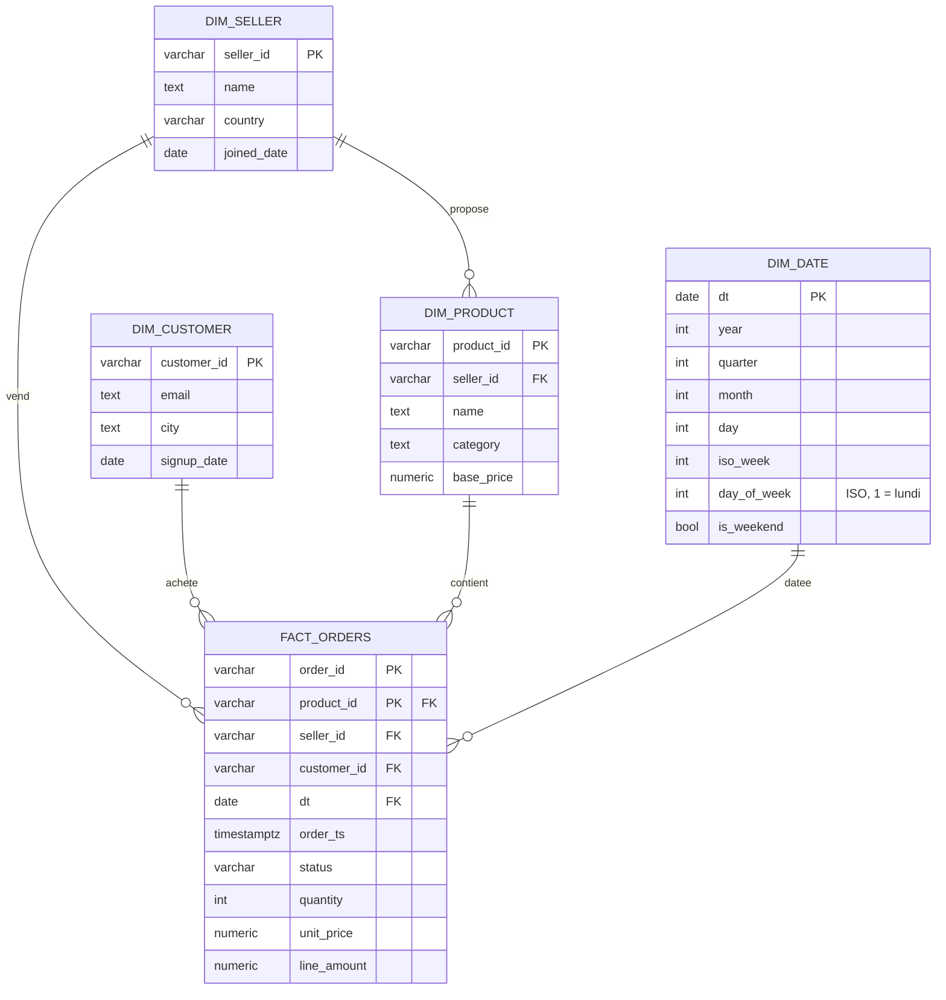
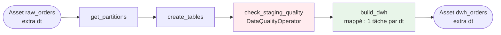

# Lot 3 — DWH et qualité

Ce lot transforme les tables `staging.*`, chargées par l'ingestion, en un **modèle en étoile**
fiable dans le schéma `dwh`. Il contrôle les données avant chaque construction et
garantit qu'un replay ne change jamais le résultat.

Les noms, le grain et le mécanisme de déclenchement sont fixés par
[contracts.md](contracts.md). Ce document décrit comment ils sont implémentés.

| Élément | Emplacement |
|---|---|
| DDL staging | [sql/staging/00_tables.sql](../sql/staging/00_tables.sql) |
| DDL et transformations DWH | [sql/dwh/](../sql/dwh/) |
| Construction transactionnelle | [plugins/dwh/build.py](../plugins/dwh/build.py) |
| Moteur de contrôles qualité | [plugins/dwh/quality.py](../plugins/dwh/quality.py) |
| Règles qualité du staging | [plugins/dwh/quality_rules.py](../plugins/dwh/quality_rules.py) |
| `DataQualityOperator` | [plugins/operators/data_quality_operator.py](../plugins/operators/data_quality_operator.py) |
| DAG | [dags/marketplace_dwh_build_daily.py](../dags/marketplace_dwh_build_daily.py) |
| Tests | `tests/test_dwh_unit.py`, `tests/test_dwh_postgres.py`, `tests/test_dwh_airflow.py` |

---

## 1. Modèle en étoile



**Grain de `fact_orders` : une ligne par produit commandé**, de clé `(order_id, product_id)`.
L'en-tête de la commande (vendeur, client, statut, horodatage) est répété sur chaque ligne.

| Besoin | Requête |
|---|---|
| Nombre de commandes | `COUNT(DISTINCT order_id)`, jamais `COUNT(*)` |
| Montant d'une commande | `SUM(line_amount) GROUP BY order_id` |
| Chiffre d'affaires | `SUM(line_amount) WHERE status IN ('paid', 'shipped', 'delivered')` |

Écarts avec le schéma du README, tous deux validés dans le contrat :
- `total_amount` devient `line_amount` ;
- `dim_product` porte `seller_id`, ce qui permet de contrôler qu'un produit appartient bien au vendeur de la commande.

Les contraintes de la base sont un second filet de sécurité, après les contrôles qualité :
- clés étrangères vers les 4 dimensions ;
- `CHECK` sur le statut ;
- `quantity > 0` et `unit_price > 0` ;
- `line_amount = quantity * unit_price`.

### Dimensions : SCD type 1

Les référentiels de staging sont une photographie complète, remplacée à chaque ingestion.
Les dimensions en sont un **upsert** :
- une entité nouvelle est insérée ;
- une entité modifiée est écrasée ;
- une entité inchangée n'est pas réécrite (`WHERE … IS DISTINCT FROM`).

Une dimension **ne perd jamais de ligne**. Un produit retiré du catalogue reste dans
`dim_product`, et les faits historiques gardent ainsi leurs clés étrangères.

`dim_date` couvre 2024-01-01 → 2027-12-31. Elle s'étend automatiquement si une date
traitée sort de cette plage.

---

## 2. Le DAG `marketplace_dwh_build_daily`



| Tâche | Rôle |
|---|---|
| `get_partitions` | Liste triée et dédoublonnée des dates à construire. Un run déclenché par un Asset n'a pas de `ds` : les dates viennent de `extra["dt"]` des événements `raw_orders`. Un run manuel prend `conf = {"dt": "YYYY-MM-DD"}` ou `{"dts": [...]}`. |
| `create_tables` | Rejoue le DDL staging + DWH (`CREATE … IF NOT EXISTS`, sans effet si tout existe). |
| `check_staging_quality` | Les 7 règles de la section 4, sur les partitions du run. Pas de retry : un échec qualité est déterministe. |
| `build_dwh` | Une instance par date (mapping dynamique), exécutées une à la fois. Chacune émet son propre événement `dwh_orders` avec `extra = {"dt": ..., "fact_lines": ...}`, ce qu'attendent les DAGs aval. |

Plusieurs ingestions peuvent s'accumuler avant qu'un run du DWH démarre, par exemple pendant
un backfill. Le run reçoit alors plusieurs événements et construit toutes les dates concernées.

---

## 3. Transformations et idempotence

`build_dwh` exécute, **dans une seule transaction par date** :

| Ordre | Fichier | Effet |
|---|---|---|
| 0 | — | `pg_advisory_xact_lock_shared(72431001)` |
| 1 | `10_dim_date.sql` | Calendrier, `ON CONFLICT DO NOTHING` |
| 2 | `11_dim_seller.sql` | Upsert SCD1 |
| 3 | `12_dim_customer.sql` | Upsert SCD1 |
| 4 | `13_dim_product.sql` | Upsert SCD1, après les vendeurs (clé étrangère) |
| 5 | `20_fact_orders_delete.sql` | `DELETE WHERE dt = :dt` |
| 6 | `21_fact_orders_insert.sql` | `INSERT … SELECT` depuis `staging.order_items` ⨝ `staging.orders` |
| 7 | `30_fact_orders_reconcile.sql` | Compare le nombre de lignes et le montant entre staging et faits. Un écart lève une exception, donc un `ROLLBACK`. |

Pourquoi le résultat est identique à chaque replay :

- **DELETE + INSERT sur la partition :** la date traitée est entièrement reconstruite. Une
  commande disparue de staging disparaît des faits, et les autres dates ne sont pas touchées.
- **Transaction unique :** une erreur au milieu (clé étrangère, rapprochement) annule tout. La
  partition garde alors son état précédent, jamais un état à moitié construit.
- **Upserts déterministes :** les dimensions ne dépendent que de la photographie de staging.
  Il n'y a ni horodatage de chargement ni séquence.
- **Verrou partagé avec l'ingestion :** l'ingestion prend le même verrou consultatif en mode
  exclusif quand elle remplace staging. Le build ne lit donc jamais une photographie à moitié
  remplacée, et deux builds peuvent tourner en parallèle.

---

## 4. Contrôles qualité

### 4.1 Les règles

Toutes les règles portent sur les partitions du run (`dt = ANY(%(dts)s)`) et comptent les
lignes fautives.

| Règle | Sévérité | Ce qui est vérifié |
|---|---|---|
| `orders_have_items` | error | Toute commande a au moins une ligne produit |
| `items_have_order` | error | Toute ligne produit appartient à une commande de la même date |
| `order_total_matches_items` | error | `total_amount = Σ quantity × unit_price` |
| `references_exist` | error | Vendeur, client et produit connus, en staging **ou** dans une dimension |
| `product_belongs_to_seller` | error | Les produits d'une commande appartiennent au vendeur de la commande |
| `valid_values` | error | Statut connu, devise EUR, quantité et prix positifs, `order_ts` (UTC) le jour `dt` |
| `unit_price_near_base_price` | **warn** | Prix payé à moins d'un facteur 3 du prix catalogue |

Trois choix à connaître :

- **Contrôler en base ce que l'ingestion valide déjà en Python.** C'est voulu : les faits sont
  construits depuis l'état réel de la base, pas depuis le JSON. Ces règles protègent aussi
  contre une écriture manuelle ou un bug futur de l'ingestion.
- **`references_exist` accepte une entité présente dans une dimension.** Sans cela, rejouer
  une ancienne date échouerait dès qu'un produit vendu ce jour-là a quitté le catalogue.
- **Les prix aberrants ne sont qu'un avertissement.** L'API simulée multiplie volontairement
  environ 1 prix sur 200 par 10. Ce sont de vraies anomalies métier, destinées à la
  détection d'anomalies de la partie 2, pas des données cassées. En bloquer le chargement
  ferait échouer le DAG environ un jour sur deux.

### 4.2 Le `DataQualityOperator`

```python
DataQualityOperator(
    task_id="check_staging_quality",
    postgres_conn_id="dwh_postgres",
    checks=STAGING_CHECKS,
    parameters={"dts": partitions},  # templated : accepte un XComArg
)
```

Une règle est un dictionnaire :

| Clé | Obligatoire | Défaut | Rôle |
|---|---|---|---|
| `name` | oui | — | Identifiant unique, affiché dans les logs et l'XCom |
| `sql` | oui | — | Requête qui renvoie **une ligne, une colonne entière** : le nombre de lignes fautives |
| `severity` | non | `"error"` | `"error"` fait échouer la tâche, `"warn"` est seulement journalisé |
| `max_failures` | non | `0` | Nombre de lignes fautives toléré |
| `description` | non | `""` | Texte lisible |

Comportement de l'Operator :

- **Configuration invalide :** une clé inconnue, un nom en double, une sévérité inconnue ou un
  seuil négatif est refusé **dès le parsing du DAG**, pas au moment du run.
- **Toutes les règles s'exécutent**, même après un échec. Le log montre donc tous les
  problèmes d'un coup :
  ```
  orders_have_items            OK       0 offending rows (max 0)
  order_total_matches_items    FAILED   3 offending rows (max 0)
  unit_price_near_base_price   WARNING  1 offending rows (max 0)
  ```
- **Résultats publiés dans tous les cas :** ils sont poussés dans l'XCom `results`, même quand
  la tâche échoue. La valeur de retour, elle, n'existe qu'en cas de succès.
- **Échec :** l'Operator lève `DataQualityError` avec la liste des règles en échec.

**Ajouter une règle :** ajouter un dictionnaire à `STAGING_CHECKS`. Sa requête doit filtrer sur
`dt = ANY(%(dts)s::date[])` et ne contenir aucun autre caractère `%`. Un test unitaire vérifie
ces deux points. Ajouter ensuite un cas de corruption dans `test_each_corruption_is_caught_by_its_rule`.

---

## 5. Exploitation

**Premier démarrage.** Les tables staging doivent exister **avant** le premier run
d'ingestion. Or `create_tables` ne s'exécute qu'après celui-ci. Une seule fois sur une base
neuve, lancer :

```powershell
Get-Content sql/staging/00_tables.sql | docker compose exec -T postgres-dwh psql -U marketplace -d marketplace
```

**Lancement normal.** Activer les deux DAGs dans l'UI. Chaque ingestion réussie déclenche le
build DWH.

**Rejouer une date** (manuellement, ou pour démontrer l'idempotence) :

```powershell
# PowerShell 7 (sous Windows PowerShell 5.1, échapper les guillemets : '{\"dt\": \"2026-10-20\"}')
docker compose exec airflow-scheduler airflow dags test marketplace_dwh_build_daily -c '{"dt": "2026-10-20"}'
```

Ou bien, depuis l'UI : *Trigger DAG w/ config* avec `{"dt": "2026-10-20"}`, ou
`{"dts": ["2026-10-18", "2026-10-19"]}` pour plusieurs dates.

**En cas d'échec de `check_staging_quality`** : le log de la tâche indique les règles en
échec et leur nombre de lignes fautives. Les tables `dwh` restent inchangées. Il faut
corriger la source, relancer l'ingestion de la date, puis le build.

---

## 6. Tests

| Fichier | Prérequis | Ce qu'il prouve |
|---|---|---|
| `test_dwh_unit.py` (29 tests) | aucun | Validation de la configuration, exécution de toutes les règles, seuils et sévérités, résolution des dates, ordre et rollback de la transaction de build |
| `test_dwh_postgres.py` (18 tests) | PostgreSQL | **3 replays → état identique** des 5 tables. Rapprochement avec les totaux de commande. Partition réingérée sans lignes périmées. **Chaque règle détecte sa corruption** (9 cas). Prix aberrant = avertissement seulement. Isolation des partitions. Build en échec = état précédent conservé. SCD1. `dim_date` indépendante du fuseau |
| `test_dwh_airflow.py` (7 tests) | Airflow | Déclenchement par `raw_orders`, ordre des tâches, build mappé qui publie `dwh_orders`, Operator : succès avec avertissement, échec avec XCom publiée, configuration refusée au parsing |

`test_dwh_postgres.py` charge staging **avec le vrai code d'ingestion et le vrai générateur
de l'API**. Il travaille dans une base jetable, créée puis supprimée à chaque test, et sa
session est volontairement en fuseau `Pacific/Auckland` pour débusquer les erreurs de date.

```powershell
pip install -r tests/requirements.txt "psycopg[binary]"

# Unitaires
pytest tests/test_dwh_unit.py

# PostgreSQL : le DWH de la stack convient (l'utilisateur a le droit CREATEDB)
$env:TEST_POSTGRES_DSN = "postgresql://marketplace:<DWH_PASSWORD>@localhost:5433/marketplace"
pytest tests/test_dwh_postgres.py

# Airflow : dans le conteneur, qui a Airflow et ses providers
docker compose cp tests airflow-scheduler:/tmp/mpa/tests   # idem pour dags, plugins, sql, api
docker compose exec -w /tmp/mpa airflow-scheduler bash -c "pip install -q --target /tmp/pylibs pytest==8.3.4 && PYTHONPATH=/tmp/pylibs python -m pytest tests/test_dwh_airflow.py"
```

### Vérification de bout en bout (21/10/2026)

Ingestion réelle du 2026-10-20 depuis l'API (45 commandes, 108 lignes produits), puis trois
`airflow dags test marketplace_dwh_build_daily -c '{"dt": "2026-10-20"}'`. Les empreintes MD5
de chaque table sont **identiques après chacun des 3 runs** :

| Table | Lignes | MD5 |
|---|---|---|
| `fact_orders` | 108 | `d43cf1e165896a33c0402aad1ccf29e4` |
| `dim_seller` | 12 | `d6176324e27f5a1c81a20103556d3bd9` |
| `dim_product` | 95 | `18595f55eaadab806fdba003b08acef7` |
| `dim_customer` | 150 | `4a2ae45fe09095cbbac5eedff43593a3` |
| `dim_date` | 1461 | `b7148301d19ea0b9328f573e99692ec7` |

Chaque run a émis un événement `dwh_orders` avec `extra = {"dt": "2026-10-20", "fact_lines": 108}`.

---

## 7. Limites connues

- **SCD1 :** l'historique d'un attribut n'est pas conservé. Le revenu passé d'un vendeur
  renommé apparaît sous son nouveau nom. Une SCD2 serait nécessaire pour un suivi historique.
- **Replay d'une date ancienne :** les dimensions prennent les valeurs de la **dernière**
  photographie de staging, pas celles du jour rejoué. C'est cohérent avec la SCD1.
- **Ce que les règles ne couvrent pas :** les seuils de volume, comme « 0 commande un jour
  ouvré ». Une journée vide est un cas légitime pour l'ingestion. Les baisses de volume
  relèvent de la détection d'anomalies de la partie 2.
